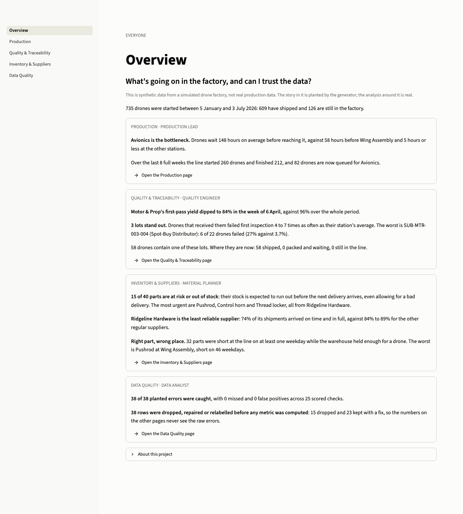

# Drone Factory Analytics

**Live app: https://drone-factory-analytics.streamlit.app/**

A simulated drone factory, its ERP/MES-style data in PostgreSQL, SQL metric views, and a Streamlit app that answers the questions a quality engineer and a material planner would ask of it.

All of the data is synthetic and generated by this repo. It is not real company data. The generator sets one story in it (a supplier crisis, a parts shortage, a defect spike), so I can check that the analysis finds what is really there.

## Why this project

I first saw Zipline in a Mark Rober video in my sophomore year, and it stayed with me. Years later, my birthday gift was my first drone, a DJI Mini 5 Pro, and flying it made me wonder what else drones could be used for. It taught me something I had not expected: the aircraft is not the important part, the network is. One drone on its own is largely insignificant; the value is in the fleet and the network around it, a fleet that is built, kept supplied and kept flying, so that it can reach people reliably, and so that anyone can use it. I started researching a business of my own to build one, and realized Zipline already does exactly that.

A network like that depends on a factory and a supply chain behind it, and I had never worked with that kind of data. This project is my version of that side. Real factory data is not public, so I built a synthetic drone factory and made it behave causally, so that a late supplier delivery shows up as a stockout, then a delay, then a quality problem. The goal was to practise defining manufacturing metrics in SQL and showing the result in a tool a non-analyst could use.

## What it shows

One story, told through two pages. The numbers below are from the default seed, 240 drones over 12 weeks.

> A supplier ships late, a part runs out, the line buys a substitute lot, that lot fails inspection far more often, and the lot number tells me exactly which drones are affected.

| Page | Asked by | Finding |
| --- | --- | --- |
| [Quality & Traceability](docs/screenshots/quality.png) | Quality engineer | Two emergency-purchase prop nut lots stand out: 40% and 55% of the drones that received them failed inspection, against about 5% for a typical lot. 40 drones contain them, all already shipped. |
| [Inventory & Suppliers](docs/screenshots/inventory.png) | Material planner | Ridgeline Hardware's prop nut delivery due 12 February arrived 11 days late, the stock ran out, and the line bought 2 emergency substitute lots. |



## How it works

```
factory/ (Python)         generate synthetic data: line simulation, parts inventory, shipping
   |                      load 10 raw tables into PostgreSQL
sql/metrics/ (SQL)        4 metric views
app/ (Streamlit)          three pages that read only the metric views
```

- **The simulation is causal, not scripted.** Drones queue for station lanes; each station draws parts from its own line-side shelf, topped up from a warehouse by supplier deliveries. A late delivery empties a shelf, the work waits, and emergency spot-buy parts are used instead. Those parts fail inspection more often, which is what produces the defect spike.
- **Metrics live in SQL.** Delivery lateness, lot failure rate and recall scope are defined in views. The app only reads them.
- **The tests cover the data and the app.** The tests cover the generator, the metric views and the pages. The full design and its reasoning are in [DOMAIN.md](DOMAIN.md).

## Run it locally

Needs Python 3 and a local PostgreSQL.

```
make setup                # virtual environment and dependencies
cp .env.example .env      # then fill in DATABASE_URL (and TEST_DATABASE_URL for the tests)
make build                # generate the data, load PostgreSQL, build the views
make run                  # open the app
make test
```

How the live copy is hosted (Neon for the database, Streamlit Community Cloud for the app) is in [HOSTING.md](HOSTING.md). The free tiers sleep when idle, so the first page after a quiet spell can take a while to load.

## Limitations

- **The data is synthetic.** The patterns are there because the generator puts them there, so this shows how I would analyze this kind of data, not what a real factory looks like.
- **It is a snapshot, not a live feed.** The data is a single extract, loaded once. The app does not stream.
- **One factory, five stations, 12 parts.** Real lines have far more parts, variants and failure modes.
- **No forecasting or machine learning.** Everything is descriptive: what happened and where.
