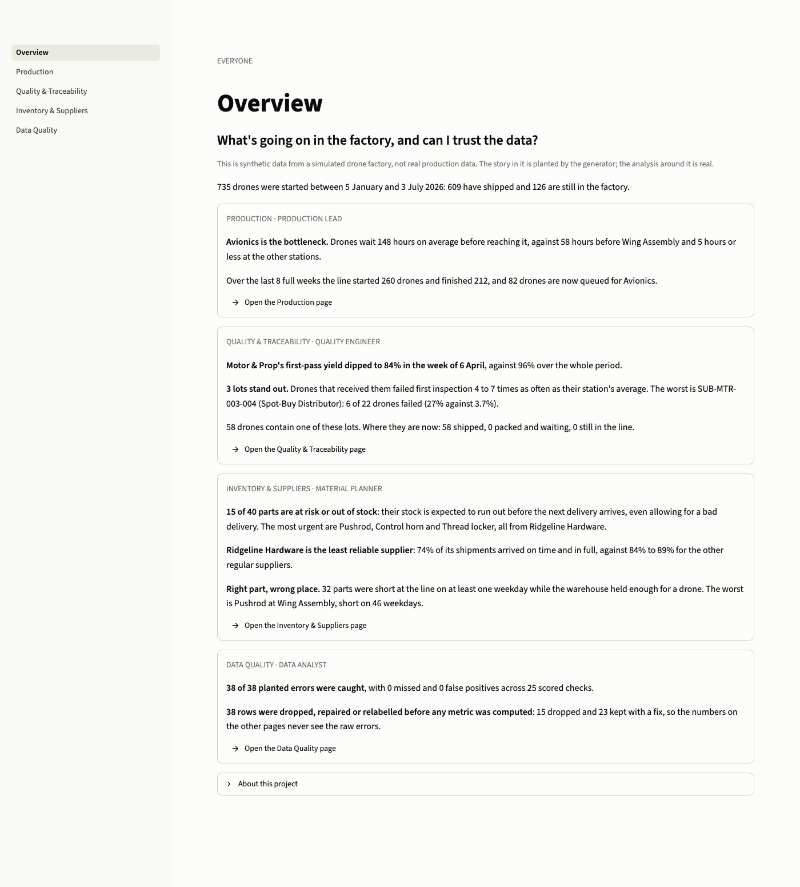

# Drone Factory Analytics

**Live app: https://drone-factory-analytics.streamlit.app/**

A simulated drone factory, its ERP/MES-style data in PostgreSQL, SQL data quality checks, and a Streamlit app that answers the questions a production lead, a quality engineer and a material planner would ask of it.

All of the data is synthetic and generated by this repo. It is not real company data. The generator plants a story in it (a bottleneck, a parts shortage, a defect spike) and some deliberate errors, so I can check that the analysis finds what is really there.

## Why this project

<!-- DRAFT: Gary, rewrite this section in your own words before relying on it. -->
I wanted to work with the kind of data a drone factory produces: work orders, inspections, parts inventory, supplier deliveries, and which part lots went into which aircraft. I like drones, and Zipline builds and flies delivery drones, so a drone line was the factory I most wanted to model. Real factory data is not public, so I built a synthetic one and made it behave causally, so that a late supplier delivery shows up as a stockout, a delay and a quality problem later on. The goal was to practise defining manufacturing metrics in SQL, checking data before trusting it, and showing the result in a tool a non-analyst could use.

## What it shows

Three questions, one per role, plus a check on the data itself. The numbers below are from the default seed, 735 drones over 26 weeks.

| Page | Asked by | Finding |
| --- | --- | --- |
| [Production](docs/screenshots/production.png) | Production lead | Avionics is the bottleneck. Drones wait about 148 hours before reaching it, against 58 hours before Wing Assembly and 5 hours or less elsewhere. |
| [Quality & Traceability](docs/screenshots/quality.png) | Quality engineer | Motor & Prop first-pass yield dipped to 84% in the week of 6 April. Tracing lots back shows 3 emergency-purchase fastener lots with failure rates 4 to 7 times their station's average, and every drone that contains one. |
| [Inventory & Suppliers](docs/screenshots/inventory.png) | Material planner | 15 of 40 parts are at risk of running out before the next delivery. Ridgeline Hardware is the least reliable supplier (74% on time and in full, against 84% to 89% for the others). |
| [Data Quality](docs/screenshots/data-quality.png) | Data analyst | 38 of 38 planted errors were caught, with 0 missed and 0 false positives across 25 scored checks. Flagged rows are dropped or repaired before any metric is computed. |



## How it works

```
factory/ (Python)         generate synthetic data: line simulation, parts inventory, shipping, planted errors
   |                      load 10 raw tables into PostgreSQL
sql/checks/ (SQL)         26 data quality checks, scored against the planted-error answer key
sql/metrics/ (SQL)        clean_* views (flagged rows removed or repaired), then 28 metric views
app/ (Streamlit)          five pages that read only the metric views
```

- **The simulation is causal, not scripted.** Drones queue for station lanes; each station draws parts from its own line-side shelf, topped up from a warehouse by supplier deliveries. A late delivery empties a shelf, the work waits, and emergency spot-buy parts are used instead. Those parts fail inspection more often, which is what produces the defect spike.
- **Data quality comes before metrics.** Six kinds of error are planted: duplicate work orders, end times before start times, inspections with no work order, missing defect codes, negative stock and over-receipts. SQL checks find them, a scorer compares the result to the answer key, and the clean views apply a written policy for each.
- **Metrics live in SQL.** First-pass yield, defect Pareto, cycle time and queue wait, supplier on-time-in-full, and days of stock against days to delivery are all defined in views. The app only reads them.
- **The tests cover the data and the app.** 299 tests cover the generator, the checks, the metric views and the pages. The full design and its reasoning are in [DOMAIN.md](DOMAIN.md).

## Run it locally

Needs Python 3 and a local PostgreSQL.

```
make setup                # virtual environment and dependencies
cp .env.example .env      # then fill in DATABASE_URL (and TEST_DATABASE_URL for the tests)
make build                # generate the data, load PostgreSQL, build the views, run the checks
make run                  # open the app
make test
```

How the live copy is hosted (Neon for the database, Streamlit Community Cloud for the app) is in [HOSTING.md](HOSTING.md). The free tiers sleep when idle, so the first page after a quiet spell can take a while to load.

## Limitations

- **The data is synthetic.** The patterns are there because the generator puts them there, so this shows how I would analyze this kind of data, not what a real factory looks like.
- **It is a snapshot, not a live feed.** The data is a single extract, loaded once. The app does not stream.
- **One factory, five stations, 40 parts.** Real lines have far more parts, variants and failure modes.
- **No forecasting or machine learning.** Everything is descriptive: what happened, where, and how sure the data is.
- **The yield dip is found with a simple statistical rule** (a z-score on weekly pass rates), chosen to be easy to explain rather than to be optimal.
